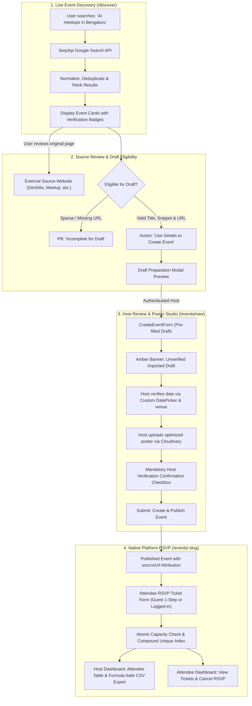

# EventScout — Live Event Discovery & Management Platform

A production-grade, full-stack event discovery, RSVP ticketing, and community organizer platform built with **Next.js 16 (App Router & Turbopack)**, **React 19**, **TypeScript**, **MongoDB Atlas**, **SerpApi**, and **Cloudinary**.

[](https://event-registration-and-management-s-seven.vercel.app/)
[](https://github.com/affanraza84/Event-Registration-and-Management-System)
[](https://www.typescriptlang.org/)
[](https://opensource.org/licenses/MIT)

* **Live Deployment**: [https://event-registration-and-management-s-seven.vercel.app/](https://event-registration-and-management-s-seven.vercel.app/)
* **Source Repository**: [https://github.com/affanraza84/Event-Registration-and-Management-System](https://github.com/affanraza84/Event-Registration-and-Management-System)
* **Author**: Affan Raza

---

## 💡 Overview & Problem Statement

### The Problem
Finding, verifying, and managing technology and community gatherings today is fragmented:
1. **Directory Fragmentation**: Technical gatherings, meetups, and conferences are scattered across dozens of disconnected platforms (Devfolio, Unstop, Meetup, Eventbrite, Lu.ma, LinkedIn, university portals). Users are forced to scour multiple directories manually.
2. **The Verification & Hallucination Trap**: Typical search engines return stale blog articles, expired listings, or unverified dates with no indication of venue authenticity or attendee capacity.
3. **The Discovery vs. Registration Divide**: Search platforms offer no host management tools, while traditional ticketing systems lack real-time discovery.

### The EventScout Solution
EventScout bridges this divide by integrating real-time web search with native platform event hosting:
* **For Attendees**: Scout live Google Search results in real time powered by the official **SerpApi Google Search API**, inspect original external sources, view evidence-based categories, and register for platform events with real-time atomic capacity management.
* **For Community Hosts**: Transform external search discoveries into verified event drafts with source attribution, upload high-resolution poster artwork via **Cloudinary**, set attendee capacities and RSVP deadlines, track registrations in a real-time host workspace, and export clean, formula-injection-safe CSV rosters.

---

## 🏛️ System Architecture

```mermaid
graph LR
    Client["Client Browser (React 19 / Tailwind CSS v4)"]
    NextServer["Next.js 16 App Router (Server Actions & Route Handlers)"]
    SerpApi["SerpApi Google Search API (search.json)"]
    Cloudinary["Cloudinary CDN (Asset Transformation & Storage)"]
    Mongo["MongoDB Atlas (Events, Users, Registrations, Rate Limits)"]

    Client -->|Live Event Discovery| NextServer
    NextServer -->|IP Rate Limiter (20 req/min)| Mongo
    NextServer -->|Server-Side Request with API Key| SerpApi
    SerpApi -->|Raw SERP Results| NextServer
    NextServer -->|Deduplicated, Scored & Ranked Events| Client

    Client -->|Poster Upload / Replacement| NextServer
    NextServer -->|Magic-Byte Binary Validation| NextServer
    NextServer -->|Stream Upload / Invalidation| Cloudinary

    Client -->|Draft Ingestion / RSVP Booking| NextServer
    NextServer -->|Atomic Transaction / Query| Mongo
```

---

## 🔄 End-to-End Workflow: Discovery to Registration



---

## ⚡ Key Features

### 1. Live Web Discovery Engine (`/discover`)
* **Real-Time SerpApi Pipeline**: Formulates natural search queries tailored to topics, Indian tech hubs (*Ranchi*, *Bengaluru*, *Delhi NCR*, *Mumbai*, *Hyderabad*, *Pune*, *Kolkata*), and dates.
* **Safe URL Normalization & Deduplication**: Strips tracking artifacts (`utm_*`, `fbclid`, `gclid`, `ref`, trailing slashes) and deduplicates events appearing across Google carousels and organic search listings.
* **Deterministic Relevance Scoring**: Transparent, auditable scoring on every card based on title matches, location alignment, category relevance, confirmed dates, and recognized event domain signals.
* **Evidence-Based Categorization**: Assigns categories strictly when explicit keyword proof exists (`Hackathons and competitions`, `Meetups and networking`, `Conferences and workshops`, `Student and campus events`), falling back to `"Unclassified"`.
* **Zero-Hallucination Policy**: If a date or venue is unconfirmed in search metadata, displays amber warning badges (`Date not confirmed`, `Location unverified`) and preserves the original source link.

### 2. Cloudinary Asset & Poster Pipeline
* **Dedicated Server Route (`/api/upload`)**: Securely handles event cover art and organizer profile pictures.
* **Magic-Byte Binary Inspection**: Validates binary headers (JPEG `FF D8 FF`, PNG `89 50 4E 47`, WebP `52 49 46 46`, GIF `47 49 46 38`) to block disguised executable files and spoofed extensions.
* **Automated Transformations**: Generates fast WebP/AVIF formats (`f_auto`), optimal quality compression (`q_auto`), and retina displays (`dpr_auto`).
* **Asset Lifecycle Management**: Automatically destroys previous Cloudinary assets when hosts replace or remove posters to prevent orphaned cloud storage.

### 3. Custom Editorial DatePicker (`DatePicker.tsx`)
* **Warm Ivory Aesthetic**: Custom popover designed in Warm Ivory (`#FAF9F6`), Deep Ink (`#171923`), and Refined Indigo (`#5146E5`).
* **Compact Proportions (~240px)**: Engineered to be ~40% more compact than bulky default calendars, preventing viewport overflow and mobile scrolling issues.
* **Month/Year Fast Switcher**: Quick-jump month grid and year stepper allowing effortless long-range date navigation without repetitive clicking.
* **Instant Selection UX**: Single-tap date selection updates form state and closes the popover immediately.
* **Date Constraints**: Enforces future event dates and locks RSVP deadlines to dates on or before the event date (`maxDate`).

### 4. Smart Time Parsing & Calendar Validation
* **Natural Time Parser (`parseStartTime`)**: Decouples date selection from empty time fields and seamlessly handles 12-hour intervals (`"10:00 AM - 4:00 PM"`), single times (`"6:30 PM"`), and 24-hour formats (`"14:30"`).
* **Timezone-Immune Calendar Evaluation**: Compares dates using local tuple representations `[year, month, day]`, preventing UTC midnight off-by-one errors.

### 5. Attendee RSVP & Concurrency Protection
* **Guest One-Step Registration**: Unauthenticated guests can register for an event, create an account, and log in simultaneously with a single form submission.
* **Double-RSVP Prevention**: Guaranteed at the database layer through a compound unique index:
  ```ts
  registrationSchema.index({ eventId: 1, attendeeId: 1 }, { unique: true });
  ```
* **Atomic Capacity Allocation**: Prevents race conditions and overbooking using atomic MongoDB operators:
  ```ts
  const updatedEvent = await Event.findOneAndUpdate(
    { _id: eventId, isClosed: false, $expr: { $lt: ["$attendeeCount", "$capacity"] } },
    { $inc: { attendeeCount: 1 } },
    { new: true }
  );
  ```
* **Cancellation & Slot Release**: Attendees can cancel RSVPs in `/my-events`, atomically releasing capacity back to the event.

### 6. Host Intelligence Workspace (`/dashboard`)
* **Interactive Table**: Powered by **TanStack Table v8** with multi-column sorting, pagination, and real-time search across attendee names, emails, and ticket IDs.
* **Capacity Indicators**: Visual progress bars and event status toggles (`Open` / `Closed`).
* **Formula-Injection-Safe CSV Export**: Protects host spreadsheets against formula injection attacks by prepending `'` and escaping quotes on fields starting with `=`, `+`, `-`, or `@`.

---

## 🛠️ Technology Stack

| Layer | Technologies | Purpose |
|---|---|---|
| **Framework** | Next.js 16.2.7 (Turbopack, App Router, Server Actions) | Core web application architecture |
| **Frontend** | React 19.2.4, Tailwind CSS v4, Lucide React | High-performance interactive UI |
| **Data Tables** | TanStack Table v8 (`@tanstack/react-table`) | Attendee management and filtering |
| **Discovery Service** | SerpApi Google Search API (`engine=google`) | Real-time web event intelligence |
| **Media Delivery** | Cloudinary API & SDK (`v2`) | Secure image upload, optimization, and CDN |
| **Database & ORM** | MongoDB Atlas, Mongoose 9.6.3 | Document database with atomic operations |
| **Authentication** | NextAuth.js 4.24, bcrypt (12 rounds) | Secure session management & credential auth |
| **Validation** | Zod 4.4, React Hook Form, `@hookform/resolvers` | Runtime schema validation |
| **Testing** | Node.js Test Runner (`tsx --test`) | Fast unit and integration tests |
| **Language & Tooling** | TypeScript 5 (Strict Mode), ESLint 9 | End-to-end type safety and code quality |

---

## 📦 Getting Started & Local Setup

### 1. Prerequisites
* [Node.js](https://nodejs.org) (v18.17+ or v20+)
* [MongoDB](https://www.mongodb.com/try/download/community) (Local instance or MongoDB Atlas cluster)
* [SerpApi Account & API Key](https://serpapi.com)
* [Cloudinary Account](https://cloudinary.com)

### 2. Clone the Repository
```bash
git clone https://github.com/affanraza84/Event-Registration-and-Management-System.git
cd Event-Registration-and-Management-System
```

### 3. Install Dependencies
```bash
npm install
```

### 4. Configure Environment Variables
Copy the template to `.env.local`:
```bash
cp .env.example .env.local
```

Populate the required environment variables:
```env
# MongoDB Connection String
MONGODB_URI=mongodb+srv://<username>:<password>@cluster0.mongodb.net/eventscout?retryWrites=true&w=majority

# NextAuth Configuration
NEXTAUTH_SECRET=your_32_character_secret_here # Generate via: openssl rand -base64 32
NEXTAUTH_URL=http://localhost:3000

# SerpApi Key (Server-Side Only - NEVER prefix with NEXT_PUBLIC)
SERPAPI_API_KEY=your_private_serpapi_api_key_here

# Cloudinary Configuration
CLOUDINARY_CLOUD_NAME=your_cloud_name
CLOUDINARY_API_KEY=your_cloudinary_api_key
CLOUDINARY_API_SECRET=your_cloudinary_api_secret
CLOUDINARY_FOLDER=eventscout/events
MAX_IMAGE_FILE_SIZE_BYTES=5242880
```

### 5. Run the Application
```bash
# Start development server with Turbopack
npm run dev

# Open application in your browser
open http://localhost:3000
```

---

## 🧪 Testing & Verification

EventScout includes comprehensive automated unit and integration tests executed using the Node.js native test runner:

```bash
# Run automated test suite
npm test
```
* **Test Suite Status**: **86 tests passing**, 29 suites, 0 failures.
* **Test Coverage**:
  * URL normalization, tracking stripping, and protocol sanitization.
  * Deterministic relevance scoring and evidence-based categorization.
  * External search draft eligibility and date extraction.
  * Cloudinary upload magic-byte verification and payload schemas.
  * Future date validation and 12-hour/24-hour time parsing.
  * Concurrency, double-RSVP prevention, and CSV injection sanitization.

```bash
# Run linter
npm run lint

# Build for production
npm run build
```
* **Linting**: 0 errors.
* **Production Build**: Successfully compiles with Turbopack, full TypeScript type safety, and static page generation across all routes.

---

## 🔒 Security & Defense-in-Depth

* **Private Key Isolation**: `SERPAPI_API_KEY` and `CLOUDINARY_API_SECRET` are strictly kept server-side. No sensitive API credentials are ever exposed in client bundles or public environment variables.
* **Distributed Rate Limiting**: `/api/discover` enforces a rate limit of 20 requests per minute per IP using a MongoDB TTL collection (`RateLimit`), with automatic in-memory fallback.
* **MIME & Magic-Byte File Inspection**: Uploaded image buffers are validated against binary file signatures before streaming to Cloudinary to prevent executable file uploads.
* **Safe External Linking**: All outgoing links generated from discovery search results enforce `target="_blank"` and `rel="noopener noreferrer"`.
* **Protocol Whitelisting**: `sourceUrl` inputs strictly permit `http://` and `https://` protocols, eliminating `javascript:` and `data:` XSS vectors.
* **CSV Injection Defense**: Spreadsheet export fields starting with `=`, `+`, `-`, or `@` are sanitized to prevent formula execution in Excel or Google Sheets.
* **Atomic Capacity Enforcement**: Conditional database updates (`attendeeCount < capacity`) prevent race conditions and overbooking under high traffic.

---

## 📄 License
This project is open-source under the [MIT License](LICENSE).
