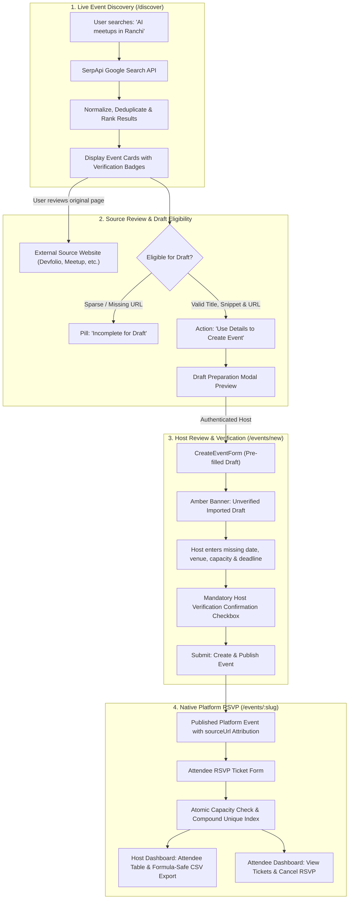

# EventScout — Live Event Discovery & Registration Platform

> **SerpApi India Hackathon 2026 Project Submission**  
> Repository: [https://github.com/affanraza84/Event-Registration-and-Management-System](https://github.com/affanraza84/Event-Registration-and-Management-System)

EventScout evolves an event registration and RSVP management system into a live event discovery engine. Powered by the official SerpApi Google Search API, EventScout enables tech enthusiasts, student developers, and community organizers across India and globally to scout upcoming hackathons, tech meetups, and conferences in real time, inspect original sources, and convert verified opportunities into platform events with native RSVP capacity management and attendee tracking.

---

## 📌 Submission Links & Demonstrations

* **Live Deployed Application**: `https://event-registration-and-management-s-two.vercel.app/discover` *(Replace with your live deployment URL)*
* **Video Demonstration (< 3 min)**: `https://drive.google.com/file/d/1rn4ueuQL3_ao8au-0jSxbnie5RJ3NnwM/view?usp=sharing` *(Replace with your video URL)*
* **Source Repository**: [https://github.com/affanraza84/Event-Registration-and-Management-System](https://github.com/affanraza84/Event-Registration-and-Management-System)

---

## 💡 Purpose & Target Users

### The Problem
Finding and managing technology events today is broken:
1. **Platform Fragmentation**: Organizers post events across disconnected platforms (Devfolio, Unstop, Meetup, Eventbrite, Lu.ma, GDG, MLH, university portals). Users must search multiple directories manually.
2. **The Verification Trap**: Ordinary web searches return mixed blog posts, expired listings, and unverified dates with no reliable way to confirm attendee capacity or RSVP.
3. **The Disconnect**: Discovery tools do not provide registration tools, and registration tools lack live discovery.

### The EventScout Solution
EventScout bridges the gap:
* **For Attendees & Hackers**: Search live Google Search results via SerpApi tailored for specific cities (e.g. *Ranchi*, *Bengaluru*, *Delhi NCR*), inspect original sources, view evidence-based categories, and register for official platform events.
* **For Community Hosts**: Scout external gatherings, convert discovered opportunities into editable unverified drafts, verify dates and venue details, set attendee capacity, and manage registrations with real-time analytics and CSV exports.

---

## 🔍 How Live SerpApi Search Powers EventScout

EventScout integrates with the official **SerpApi Google Search API** (`https://serpapi.com/search.json`) through a secure, server-side pipeline:

1. **Intelligent Query Formulation**: Transforms user topics, target cities, and dates into natural search queries (e.g. `upcoming AI meetups and hackathons in Ranchi October 2026`).
2. **Safe URL Normalization & Deduplication**: Strips tracking artifacts (`utm_*`, `fbclid`, `gclid`, `ref`, etc.) and protocol inconsistencies. Identical event pages appearing in Google rich carousels (`events_results`) and web listings (`organic_results`) are deduplicated.
3. **Deterministic Relevance Scoring**: Ranks events based on auditable signals:
   * Title keyword match (`+25`) & description snippet match (`+10`)
   * Location in title/venue (`+25`) & description mention (`+15`)
   * Category match (`+20`)
   * Verified event date present (`+15`)
   * Recognized event domain bonus (`+10`)
4. **Evidence-Based Categorization**: Assigns one of four categories *only* when explicit keyword evidence exists, falling back strictly to `"Unclassified"`:
   * `Hackathons and competitions`
   * `Meetups and networking`
   * `Conferences and workshops`
   * `Student and campus events`
5. **Zero-Hallucination Policy**:
   * If a date is not confirmed in search metadata, displays **"Date not confirmed"** with an amber indicator.
   * If venue is not confirmed, displays **"Location unverified"**.
   * Preserves the original source URL on every card with direct external navigation.

---

## 🔄 How Discovery Connects to Platform Registration

EventScout connects external discovery to the platform's host drafting and RSVP workflow:



1. **Review**: The user inspects the external search result and verifies facts on the original source website.
2. **Eligibility Guard**: The system evaluates if the result has sufficient data (`evaluateDraftEligibility`). Incomplete or malformed entries are disabled.
3. **Draft Preparation**: Clicking **"Use Details to Create Event"** displays an informative modal highlighting unverified fields and routes to `/events/new`.
4. **Host Authorization**: Only registered hosts can review and publish drafts. Unauthenticated users are redirected to login with preserved callback state.
5. **Unverified Draft Review**: The host reviews pre-filled title, description, and source link, manually fills missing dates/venues/capacities, checks the verification confirmation, and submits.
6. **Native RSVP Registration**: Once published in MongoDB, attendees can RSVP with real-time capacity checks (`attendeeCount < capacity`), duplicate RSVP prevention, and cancellation slot releases.

---

## 🏛️ System Architecture

```mermaid
graph LR
    Client["Client Browser (React 19 / Tailwind CSS v4)"]
    NextServer["Next.js 16 App Router (Server Actions & Route Handlers)"]
    SerpApi["SerpApi Google Search API (search.json)"]
    Mongo["MongoDB Atlas (Events, Attendees, Hosts, Registrations, Rate Limits)"]

    Client -->|Search Query| NextServer
    NextServer -->|Check Rate Limit (20 req/min)| Mongo
    NextServer -->|Server-Side Request with SERPAPI_API_KEY| SerpApi
    SerpApi -->|Raw Google Search JSON| NextServer
    NextServer -->|Normalized, Deduplicated & Ranked Events| Client

    Client -->|Submit Draft / Register RSVP| NextServer
    NextServer -->|Atomic Transaction / Query| Mongo
```

---

## ⚡ Main Features

### 1. Live Web Discovery (`/discover`)
* Real-time search by keyword topic, city/location, category, and date.
* Quick-pick buttons for Indian tech hubs (*Ranchi*, *Bengaluru*, *Delhi NCR*, *Mumbai*, *Hyderabad*, *Pune*, *Kolkata*).
* Suggested search queries for instant discovery.
* Multi-state UI: Loading skeleton with spinner, empty results, network errors, validation errors, and active result counts.
* Client-side category filtering with live count badges.

### 2. Event Intelligence & Ranking
* Normalized URL deduplication across Google Carousel and organic search results.
* Transparent relevance signals on every card (e.g. `Keyword match in title • Location matched: Ranchi`).
* Verified date indicator vs `Date not confirmed` clock badge.
* Preserved original source URL link on every result card.

### 3. Host Event Management (`/events/new`, `/dashboard`)
* Draft preparation from external discovery results with source attribution (`sourceUrl`).
* Slug generator with automatic collision resolution (`byamn-meetup-2026-1`).
* Unverified imported draft banner and host verification confirmation checkbox.
* Date constraints: Event dates and registration deadlines must be in the future, with deadline $\le$ event date.
* Host dashboard powered by TanStack Table with search, event filters, attendee counts, and capacity progress bars.
* CSV export with spreadsheet formula injection protection.

### 4. Attendee RSVP & Management (`/events/:slug`, `/my-events`)
* One-step RSVP: Guest attendees can provide name, email, and password to create an account, log in, and register simultaneously.
* Double-RSVP prevention via compound database index `{ eventId, attendeeId }`.
* Atomic capacity allocation with automatic closure when full.
* Attendee dashboard to view tickets and cancel RSVPs to release capacity.

---

## ⚠️ Known Limitations

1. **SerpApi Quota Dependency**: Live web discovery relies on SerpApi account query credits. When exhausted, the endpoint returns a clear 429 error without crashing.
2. **Third-Party Data Accuracy**: External event organizers may alter dates or venues on third-party sites. EventScout therefore mandates host review before publication and labels unconfirmed fields clearly.
3. **No Direct Web Scraping**: In strict compliance with security best practices, EventScout does not bypass access controls or scrape private external pages beyond official SerpApi Google Search API results.

---

## 🛠️ Technology Stack

| Layer | Technologies |
|---|---|
| **Framework** | Next.js 16.2.7 (App Router, Turbopack, Server Actions) |
| **Frontend** | React 19.2.4, Tailwind CSS v4, Lucide React, TanStack Table v8 |
| **Discovery Service** | Official SerpApi Google Search API (`engine=google`) |
| **Database & ORM** | MongoDB Atlas, Mongoose 9.6.3 |
| **Authentication** | NextAuth.js 4.24, bcrypt (cost factor 12) |
| **Validation** | Zod 4.4, React Hook Form, `@hookform/resolvers` |
| **Testing** | Node.js Test Runner (`tsx --test`) |
| **Language** | TypeScript 5 (Strict Mode), ESLint 9 |

---

## 📦 Local Setup & Installation

### 1. Prerequisites
* [Node.js](https://nodejs.org) (v18.17+ or v20+)
* [MongoDB](https://www.mongodb.com/try/download/community) (Local instance or MongoDB Atlas connection string)
* [SerpApi Account & API Key](https://serpapi.com)

### 2. Clone the Repository
```bash
git clone https://github.com/affanraza84/Event-Registration-and-Management-System.git
cd Event-Registration-and-Management-System
```

### 3. Install Dependencies
```bash
npm install
```

### 4. Configure Environment Variables
Copy the template to `.env.local`:
```bash
cp .env.example .env.local
```

Edit `.env.local` with your configuration:
```env
# MongoDB Connection String
MONGODB_URI=mongodb+srv://<username>:<password>@cluster0.mongodb.net/eventscout?retryWrites=true&w=majority

# NextAuth Configuration
NEXTAUTH_SECRET=your_32_character_secret_here # Generate via: openssl rand -base64 32
NEXTAUTH_URL=http://localhost:3000

# SerpApi Key (Server-Side Only - NEVER prefix with NEXT_PUBLIC)
SERPAPI_API_KEY=your_private_serpapi_api_key_here
```

### 5. How to Obtain a SerpApi API Key
1. Visit [serpapi.com](https://serpapi.com) and create a free account.
2. Navigate to your **Dashboard** -> **API Key**.
3. Copy your private 64-character hex key.
4. Paste it into `.env.local` as `SERPAPI_API_KEY`.

### 6. Run the Application
```bash
# Start development server
npm run dev

# Open application in browser
open http://localhost:3000
```

---

## 🧪 Testing & Quality Assurance

EventScout includes unit and integration tests executed using the Node.js test runner:

```bash
# Run automated test suite
npm test
```
* **Test Suites**: 23 suites, **68 tests passing**, 0 failing.
* **Coverage**: URL normalization, tracking stripping, duplicate removal, relevance scoring, evidence-based categorization, draft eligibility, date extraction, schema validation, rate-limiting, and CSV formula sanitization.

```bash
# Run linter
npm run lint

# Build for production
npm run build
```
* **Linting**: 0 errors.
* **Build**: Successfully compiles with Turbopack, full TypeScript type safety, and static page generation across all 11 application routes.

---

## 🔒 Security & Reliability Considerations

* **API Key Exclusivity**: `SERPAPI_API_KEY` is strictly confined to server-side execution. It is never exposed in client bundles, responses, logs, or `NEXT_PUBLIC` variables.
* **Distributed Rate Limiting**: `/api/discover` enforces 20 requests per minute per IP using a MongoDB TTL collection (`RateLimit`), with automatic in-memory fallback.
* **Safe External Linking**: All outgoing external links enforce `target="_blank"` and `rel="noopener noreferrer"` to prevent reverse tab-nabbing.
* **Protocol Whitelisting**: `sourceUrl` validation strictly permits `http://` and `https://` schemes, rejecting `javascript:` or `data:` URLs.
* **CSV Injection Defense**: CSV exports neutralize formula execution triggers (`=`, `+`, `-`, `@`) by prepending `'` and escaping quotes.
* **Atomic Capacity Enforcement**: Conditional database updates (`attendeeCount < capacity`) prevent race conditions and overbooking.

---

## 📄 License
This project is open-source under the MIT License.
